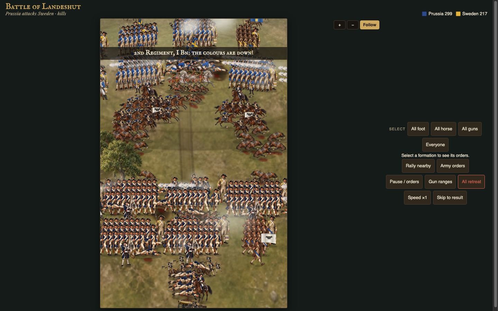

# Musket & Crown

A mobile-first, offline strategy game set in Europe from 1740. Pick one of six crowns, run an economy season by season, and steer every battle live — masses of painted figures, smoke that lingers, forts that crumble, and rivals that learn.

Inspirations: *The Ancient Art of War*, *Fantasy Empires*, *Stronghold*, *Civil War 1862*.

**Play:** the Vercel deployment of this repo (installable as an app; works offline after the first visit).



## Quick start

No dependencies beyond Python 3 and (for checks) Node.js.

```bash
python3 build.py                  # assemble game/musket-crown.html and offline/index.html
cd offline && python3 -m http.server 8000   # then open http://localhost:8000
```

Or just open `game/musket-crown.html` directly in a browser after building.

## Repository layout

| Path | What it is |
|---|---|
| `game/` | Source: `shell.html` (markup/CSS), `script.js` (campaign, AI, rendering), `battle.js` (battle sim, no DOM), `sound.part.js` (synth audio), `brains.json` (trained rival AI) |
| `build.py` | Inlines source + art into one page. Writes `game/musket-crown.html` (git-ignored) and `offline/index.html` |
| `offline/` | Deployable PWA: `index.html`, service worker, manifest, icons. **This is what Vercel serves** |
| `assets/` | Painted art (`realistic/`) and editable sources; see [`assets/README.md`](assets/README.md) |
| `tools/` | Node checks, campaign simulator, balance tuner, sprite generators, `smoke.sh` |
| `docs/` | Design, checklist, architecture, development and deployment docs, screenshots, audio previews |

## Documentation

- [Design document](docs/DESIGN.md) — every rule and number in the game
- [Feature checklist](docs/CHECKLIST.md) — what's done, what needs tuning
- [Architecture](docs/ARCHITECTURE.md) — how the pieces fit together
- [Development & testing](docs/DEVELOPMENT.md) — build, checks, smoke test, review routes
- [Deployment](docs/DEPLOYMENT.md) — GitHub + Vercel
- [Developer handoff](docs/HANDOFF.md) — implementation history and where each feature lives
- [Graphics and strategy sweep](docs/GRAPHICS_GAMEPLAY_SWEEP.md) — October 15 fixes, completed follow-up and validation limits
- [Battle scene review](docs/BATTLE_SCENE_REVIEW.md) — art sweep status
- [Assets](assets/README.md) — art inventory and re-export steps

## Golden rule

Edit the sources in `game/`, then run `python3 build.py`. Never hand-edit `offline/index.html` — it is generated. Commit the rebuilt `offline/` together with the source change so the deployment matches.
